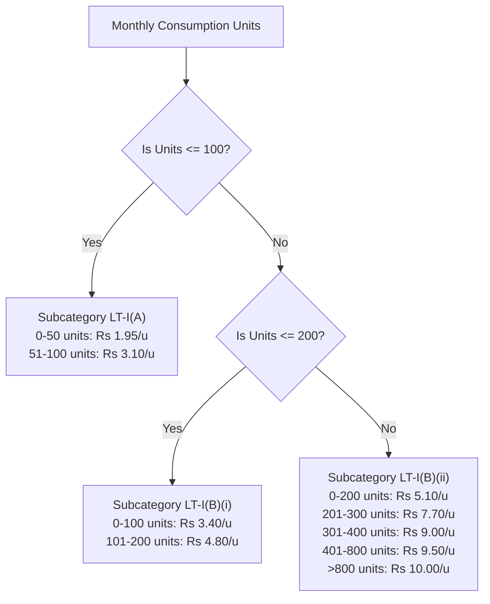
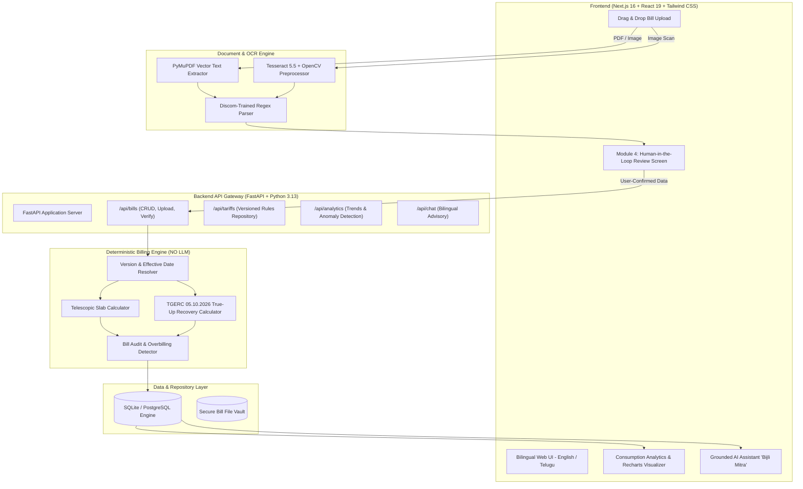

# BIJLI MITRA AI (బిజిలీ మిత్ర AI)
### Personalized Electricity Billing Assistance & Regulatory Transparency Platform
**Telangana Government Innovation Challenge 13 — Energy Department**  
*Source Reference: [TISC Telangana](https://tisc.telangana.gov.in)*

---

## ⚡ Executive Summary

Electricity consumers in Telangana frequently encounter complex monthly electricity bills containing cryptic charge line items, slab jumps, fuel surcharges, arrears, and regulatory adjustments. Domestic consumers often cannot determine:
- How their energy charges are telescopic across slabs.
- Why crossing 100 or 200 units triggers a substantial rate increase ("bracket cliff").
- What statutory components like Customer Charges, Electricity Duty, and Fuel Cost Adjustments represent.
- How historical True-Up recoveries (such as the landmark TGERC Order dated 05.10.2026) are calculated.
- Whether they qualify for zero-billing under the state Government's **Gruha Jyothi** scheme ($\le 200$ units/month).
- Whether their physical bill contains computational anomalies or overbilling subject to the statutory **18% p.a. refund interest** under TGERC Regulation 04 of 2026.

**BIJLI MITRA AI** is a production-ready, full-stack platform designed to demystify Telangana electricity bills for **TGSPDCL** (Southern Power Distribution Company of Telangana Ltd) and **TGNPDCL** (Northern Power Distribution Company of Telangana Ltd) domestic LT consumers.

It integrates:
1. **Document-Grounded Tariff Intelligence:** Derived directly from 19 official regulatory orders, tariff schedules, and legal Gazette notifications.
2. **Deterministic Calculation Engine:** **Zero LLM hallucinations** in mathematics. 100% auditable Python calculation pipeline.
3. **Multi-Format Extraction Pipeline:** High-resolution digital PDF text extraction via PyMuPDF and scanned image OCR via Tesseract 5.5 + OpenCV.
4. **Human-in-the-Loop Review Screen (Module 4):** Consumers verify and correct extracted readings and dates prior to calculation.
5. **Component Separation & True-Up Engine:** Distinct mathematical accounting for Energy Charges, Customer Charges, Fixed Charges, State Electricity Duty, FSA/FCA, True-Up Recovery, Arrears, and Gruha Jyothi credits.
6. **Bilingual Advisory & Assistant:** Interactive dashboards and AI chat in both **English and Telugu (తెలుగు)**.

---

## 📂 Official Regulatory Source Documents

The system was designed following an exhaustive regulatory audit of the 19 attached orders and regulations in the workspace:

| Document Filename | Issuing Authority | FY / Period | Category & Key Coverage |
| :--- | :--- | :--- | :--- |
| `Tariff Schedule 2026-27.pdf` | TGERC / TG Discoms | FY 2026-27 | Scanned PDF (OCRed). Latest LT-I domestic tariff slabs, fixed charges, customer charges. |
| `RST Schedule for FY 2025-26.pdf` | TGERC / TG Discoms | FY 2025-26 | Scanned PDF (OCRed). Retail Supply Tariff order for domestic LT-I. |
| `RST Schedule for FY 2024-25.pdf` | TSERC / TG Discoms | FY 2024-25 | Scanned PDF (OCRed). Introduced Rs 50/kW fixed charge for consumption >800 units (effective 01.11.2024). |
| `RST Order for FY 2023-24.pdf` | TSERC | FY 2023-24 | Retail supply tariff schedule; flat Rs 10/kW fixed charges across all domestic slabs. |
| `RST Order for FY 2022-23.pdf` | TSERC | FY 2022-23 | Historical retail supply tariff order baseline. |
| `Order regarding Gruha Jyothi Scheme.pdf` | TGERC / Govt of TG | 2024–Present | G.O.Ms.No.7 & O.P. No. 6 of 2024. Zero-bill guidelines for $\le 200$ units/month. |
| `Trueup order for FY 2022-23 and FY2023-24.pdf` | TGERC | Oct 2026 Order | Landmark True-Up order dated 05.10.2026. Authorizes recovery starting Nov 2026. |
| `Trueup order for FY 2022-23 and FY2023-24 (1).pdf` | TGERC | Duplicate | Exact SHA-256 hash match (`9f7038ef...`) to `Trueup order for FY 2022-23 and FY2023-24.pdf`. |
| `True-Up Order FY 2022-23, 2023-24, 2024-25.pdf` | TGERC | Comprehensive | Comprehensive distribution business true-up determination. |
| `TSERC (MYT) Regulation,2of 2023.pdf` | TSERC | Multi-Year Tariff | Clause 13: Monthly Fuel Surcharge Adjustment (FSA) cap of **Rs 0.30/unit**. |
| `KVArh Proceeding No.07.pdf` | TSERC | Commercial/HT | Scanned PDF (OCRed). kVAh/kVArh billing guidelines (HT/non-domestic). |
| `Electricity Supply Code Third Amendment (1).pdf` | TGERC | 2026 Regulation | Reg 04 of 2026, Clause 4.7.3: Mandatory **18% p.a. interest** on overbilling refunds. |
| `Documents_and_Connection_Charges_for_NewServices.pdf` | TGSPDCL | Guidelines | Service connection fees, development charges, security deposits. |
| 6 Additional Legal Regulations | TSERC / TGERC | Statutory | Consumer Grievance Redressal (CGRF), Terms of Supply, Standards of Performance. |

*Full analysis reports are maintained in `docs/`:*
- [`DOCUMENT_INVENTORY.md`](file:///Users/bhanuprasad/AIBILL/docs/DOCUMENT_INVENTORY.md)
- [`SOURCE_REGISTER.md`](file:///Users/bhanuprasad/AIBILL/docs/SOURCE_REGISTER.md)
- [`TARIFF_EXTRACTION_REPORT.md`](file:///Users/bhanuprasad/AIBILL/docs/TARIFF_EXTRACTION_REPORT.md)
- [`BILLING_RULES_REPORT.md`](file:///Users/bhanuprasad/AIBILL/docs/BILLING_RULES_REPORT.md)
- [`DATA_GAPS_AND_UNVERIFIED_ITEMS.md`](file:///Users/bhanuprasad/AIBILL/docs/DATA_GAPS_AND_UNVERIFIED_ITEMS.md)

---

## 📐 Regulatory Domain Rules & Tariff Formulas

### 1. Telescopic Energy Charges & The Domestic "Cliff Effect"
In Telangana, domestic Low Tension (LT-I) consumers are categorized based on their total monthly consumption. Once a threshold is crossed, the rates applied to lower-tier units shift upward:



> **The 100 & 200 Unit "Cliff":**
> - A household consuming **100 units** pays: $(50 \times 1.95) + (50 \times 3.10) = \text{Rs. } 252.50$.
> - A household consuming **101 units** jumps to LT-I(B)(i): $(100 \times 3.40) + (1 \times 4.80) = \text{Rs. } 344.80$. A 1-unit increase causes a **Rs. 92.30** jump!
> - A household consuming **200 units** pays: $(100 \times 3.40) + (100 \times 4.80) = \text{Rs. } 820.00$.
> - A household consuming **201 units** jumps to LT-I(B)(ii): $(200 \times 5.10) + (1 \times 7.70) = \text{Rs. } 1,027.70$. A 1-unit increase causes a **Rs. 207.70** jump!

### 2. Customer Charges Schedule
Statutory customer charges are applied as a monthly flat fee based strictly on consumption brackets:
$$\text{Customer Charge} = \begin{cases}
\text{Rs. } 40 & \text{if } U \le 50 \\
\text{Rs. } 70 & \text{if } 51 \le U \le 100 \\
\text{Rs. } 90 & \text{if } 101 \le U \le 200 \\
\text{Rs. } 100 & \text{if } 201 \le U \le 300 \\
\text{Rs. } 120 & \text{if } 301 \le U \le 400 \\
\text{Rs. } 140 & \text{if } 401 \le U \le 800 \\
\text{Rs. } 160 & \text{if } U > 800
\end{cases}$$

### 3. Fixed Charges Evolution
- **FY 2023-24:** Flat **Rs. 10 / kW / month** of contracted load across all domestic consumption slabs.
- **FY 2024-25, FY 2025-26, FY 2026-27:**
  - $U \le 800$ units: **Rs. 10 / kW / month**
  - $U > 800$ units: **Rs. 50 / kW / month** *(introduced via RST 2024-25, effective 01.11.2024)*

### 4. State Electricity Duty
Under the Telangana State Electricity Duty Act, 1939:
$$\text{Electricity Duty} = U \times \text{Rs. } 0.06\text{ per kWh (6 paise/unit)}$$

### 5. Fuel Surcharge Adjustment (FSA / FCA)
Governed by TSERC (MYT) Regulation 2 of 2023, Clause 13. Subject to a strict regulatory ceiling:
$$\text{Max Allowed FSA Rate} = \text{Rs. } 0.30\text{ per kWh}$$

### 6. Landmark TGERC True-Up Recovery Order (05.10.2026)
Approved in TGERC Order dated October 5, 2026, for recovery of FY 2022-23 & FY 2023-24 revenue gaps:
- **Commencement:** Billing month of **November 2026**.
- **Scope:** All non-agricultural consumers (including domestic LT-I).
- **Rate Schedule:**
  - Month 1 (November 2026): **Rs. 0.30 per unit**
  - Month 2 through end: **Rs. 0.50 per unit**
- **Recovery Duration:**
  - **TGSPDCL:** 29 billing months
  - **TGNPDCL:** 26 billing months
- **Monthly Recovery Quantum:** Calculated on $\frac{1}{12}\text{th}$ of the consumer's average annual consumption during FY 2022-23 and FY 2023-24:
$$\text{Monthly True-Up Amount} = \left(\frac{\text{Historical Annual Units}}{12}\right) \times \text{Applicable Rate}$$
- **Regulatory Requirement:** Must be billed as an independent line item and **never** merged into Energy Charges or Arrears.

### 7. Gruha Jyothi Zero-Bill Rules (G.O.Ms.No.7 & O.P. No. 6 of 2024)
- **Eligibility:** Valid Praja Palana application, White Ration Card (Food Security Card) linked with Aadhaar and domestic service connection.
- **Consumption Threshold:** Monthly consumption $\le 200$ units.
- **Subsidy Mechanism:** Government compensates DISCOMs for 100% of Energy Charges, Customer Charges, and Electricity Duty.
- **Strict Disqualification ("Zero or Nothing"):** If consumption reaches **201 units**, the subsidy is **Rs. 0.00**. The consumer is billed the full LT-I(B)(ii) charge of Rs. 1,027.70+.

### 8. Statutory 18% p.a. Overbilling Refund Interest
Under TGERC Electricity Supply Code Third Amendment Regulation 2026 (Reg 04 of 2026, Clause 4.7.3):
$$\text{Refund Amount} = \text{Excess Billed} + \left(\text{Excess Billed} \times \frac{18}{100} \times \frac{\text{Days of Overcharge}}{365}\right)$$

---

## 🏗️ System Architecture



---

## 🛠️ Tech Stack & Directory Structure

- **Backend:** FastAPI, Python 3.13, SQLAlchemy, Pydantic v2, PyMuPDF (fitz), Tesseract OCR 5.5, OpenCV (opencv-python-headless), Pytest.
- **Frontend:** Next.js 16 (Turbopack), React 19, TypeScript, Tailwind CSS, Lucide React, Recharts.
- **Database:** SQLite (default development) / PostgreSQL 15 (Docker production).

```text
/Users/bhanuprasad/AIBILL/
├── README.md                                  # Master Project Documentation
├── docker-compose.yml                         # Multi-container orchestration (DB, API, Web)
├── .env.example                               # Environment configuration template
├── docs/                                      # Regulatory & Architectural Markdown Reports
│   ├── DOCUMENT_INVENTORY.md                  # Comprehensive inventory of all 19 documents
│   ├── SOURCE_REGISTER.md                     # Regulatory citations, pages, and clauses
│   ├── TARIFF_EXTRACTION_REPORT.md            # Extracted schedules for FY23-24 through FY26-27
│   ├── BILLING_RULES_REPORT.md                # Mathematical formulas & edge cases
│   ├── DATA_GAPS_AND_UNVERIFIED_ITEMS.md      # Unverified items & verification protocols
│   ├── ARCHITECTURE.md                        # Detailed system architecture
│   └── API_DOCUMENTATION.md                   # Complete REST API reference
├── backend/                                   # FastAPI Backend Application
│   ├── Dockerfile                             # Container definition with Tesseract 5.5
│   ├── requirements.txt                       # Python dependencies
│   ├── bijli_mitra.db                         # Seeded SQLite database with 5 demo bills
│   ├── app/
│   │   ├── main.py                            # FastAPI app & lifespan initialization
│   │   ├── core/                              # Config & database engine
│   │   ├── models/                            # SQLAlchemy ORM models
│   │   ├── extraction/                        # PyMuPDF, Tesseract OCR & regex parser
│   │   ├── tariff_engine/                     # Deterministic billing & True-Up calculation engine
│   │   ├── analytics/                         # Consumption trends & energy saving advisor
│   │   ├── ai/                                # Grounded bilingual AI assistant
│   │   └── api/                               # REST API routers (bills, tariffs, analytics, chat)
│   └── tests/                                 # Pytest automated test suite
│       ├── test_tariff_engine.py              # Mathematical tariff verification tests
│       ├── test_extraction.py                 # OCR & regex parser tests
│       └── test_api.py                        # REST API endpoint integration tests
├── frontend/                                  # Next.js 16 Web Application
│   ├── Dockerfile                             # Multi-stage production container
│   ├── package.json                           # React 19 & Lucide dependencies
│   ├── app/
│   │   ├── page.tsx                           # Full bilingual interactive application (8 tabs)
│   │   ├── layout.tsx                         # Root HTML layout & fonts
│   │   └── globals.css                        # Tailwind styling
│   └── lib/
│       └── api.ts                             # Typed TypeScript API client
├── storage/bills/                             # Uploaded bill storage vault
├── extracted_text/                            # Cached OCR & digital PDF extracts
└── OFFICIAL_TARIFF_ORDERS/                    # Attached official tariff regulatory orders
```

---

## 🚀 Quickstart Guide

### Option 1: Running Locally (Fastest)

#### Step 1: Start Backend (FastAPI)
Ensure Python 3.11+ and Tesseract OCR are installed:
```bash
cd /Users/bhanuprasad/AIBILL

# Activate Python virtual environment
source venv/bin/activate

# Start FastAPI server on port 8000
python -m uvicorn backend.app.main:app --host 0.0.0.0 --port 8000 --reload
```
The interactive Swagger API documentation will be available at:  
👉 **http://localhost:8000/docs**

#### Step 2: Start Frontend (Next.js)
In a separate terminal:
```bash
cd /Users/bhanuprasad/AIBILL/frontend

# Install dependencies if not already installed
npm install

# Start Next.js development server on port 3000
npm run dev
```
The application will be live at:  
👉 **http://localhost:3000**

---

### Option 2: Running via Docker Compose

Run the entire stack (PostgreSQL + FastAPI + Next.js) with a single command:
```bash
docker compose up --build
```
- Web Application: **http://localhost:3000**
- Backend API Docs: **http://localhost:8000/docs**

---

## 🧪 Verification & Test Suite

The system includes a test suite covering the deterministic billing engine, OCR parsing, True-Up math, Gruha Jyothi edge cases, and API routes.

### Run Backend Unit & Integration Tests:
```bash
cd /Users/bhanuprasad/AIBILL
PYTHONPATH=. ./venv/bin/pytest backend/tests/ -v
```

**Verification Results:**
```text
============================= test session starts ==============================
collected 16 items

backend/tests/test_tariff_engine.py::test_lt1a_calculation PASSED        [  6%]
backend/tests/test_tariff_engine.py::test_lt1bi_calculation PASSED       [ 12%]
backend/tests/test_tariff_engine.py::test_lt1bii_calculation PASSED      [ 18%]
backend/tests/test_tariff_engine.py::test_gruha_jyothi_zero_bill PASSED  [ 25%]
backend/tests/test_tariff_engine.py::test_gruha_jyothi_disqualification PASSED [ 31%]
backend/tests/test_tariff_engine.py::test_fixed_charge_high_consumption PASSED [ 37%]
backend/tests/test_tariff_engine.py::test_true_up_recovery_calculation PASSED [ 43%]
backend/tests/test_tariff_engine.py::test_historical_bill_different_tariffs PASSED [ 50%]
backend/tests/test_extraction.py::test_bill_parser_tgspdcl PASSED        [ 56%]
backend/tests/test_extraction.py::test_bill_parser_gruha_jyothi PASSED   [ 62%]
backend/tests/test_api.py::test_health_check PASSED                      [ 68%]
backend/tests/test_api.py::test_get_tariffs PASSED                       [ 75%]
backend/tests/test_api.py::test_list_bills PASSED                        [ 81%]
backend/tests/test_api.py::test_calculate_bill PASSED                    [ 87%]
backend/tests/test_api.py::test_analytics_trends PASSED                  [ 93%]
backend/tests/test_api.py::test_chat_assistant PASSED                   [100%]

============================== 16 passed in 0.65s ==============================
```

### Run Frontend Production Build Check:
```bash
cd /Users/bhanuprasad/AIBILL/frontend
npm run build
```
**Build Output:**
```text
✓ Compiled successfully in 348ms
✓ Generating static pages (5/5)
✓ Finalizing page optimization
Page (app)                              Size     First Load JS
┌ ○ /                                   7.39 kB         114 kB
└ ○ /_not-found                         994 B           107 kB
+ First Load JS shared by all           106 kB
```

---

## 💡 Key Features Implemented

| Module | Feature | Capability |
| :--- | :--- | :--- |
| **Module 1** | **User Dashboard** | Consumption summary, month-over-month trend indicators, Gruha Jyothi status pill, quick upload trigger. |
| **Module 2** | **Bill Upload** | Supports PDF, JPG, PNG formats; drag-and-drop; duplicate detection via SHA-256 hashing. |
| **Module 3** | **OCR & Data Extraction** | Hybrid pipeline (PyMuPDF for digital PDFs, Tesseract 5.5 + OpenCV for scans); captures 18+ fields with confidence scores. |
| **Module 4** | **Consumer Review Screen** | Full verification interface allowing consumers to inspect OCR results, correct readings/dates, and approve before billing. |
| **Module 5** | **Tariff Billing Engine** | 100% deterministic, zero-LLM calculation engine; versioned tariff schedules (FY23-24 to FY26-27); TGERC True-Up calculator. |
| **Module 6** | **Discrepancy & Explanations** | Discrepancy detector flagging overcharges ($\ge\text{Rs. } 5$), arrears, and calculating 18% statutory refund interest. |
| **Module 7** | **Analytics & Trends** | Interactive Recharts graph of 6-month consumption and bill history; bracket shift alerts. |
| **Module 8** | **Savings Advisor** | Personalized energy-saving recommendations calculating exact Rupee savings for appliance efficiency and bracket-drops. |
| **Module 9** | **Bilingual AI Assistant** | Grounded chat assistant answering tariff queries in natural English and Telugu with regulatory citations. |

---

## 📜 Regulatory Citations & Legal Disclaimers

1. **Tariff Orders:** Retail Supply Tariff Orders for FY 2022-23, FY 2023-24, FY 2024-25, FY 2025-26, and FY 2026-27 issued by the Telangana Electricity Regulatory Commission (TGERC/TSERC).
2. **True-Up Order:** TGERC Order dated **October 5, 2026**, for FY 2022-23 and FY 2023-24.
3. **Gruha Jyothi Scheme:** Government of Telangana G.O.Ms.No.7 (Energy Dept) and TGERC O.P. No. 6 of 2024.
4. **Overbilling Statutory Interest:** TGERC Electricity Supply Code Third Amendment Regulation, 2026 (Regulation No. 04 of 2026), Clause 4.7.3.
5. **Disclaimer:** *BIJLI MITRA AI is an independent advisory and transparency platform developed for Telangana Government Challenge 13. Calculations are derived strictly from official TGERC/TSERC public orders. For legal disputes or official bill corrections, consumers must contact their respective TGSPDCL or TGNPDCL Sub-Divisional Office or file a petition with the Consumer Grievances Redressal Forum (CGRF).*
