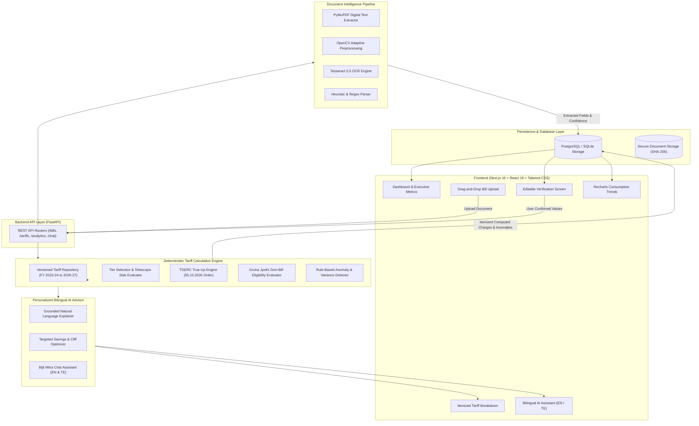
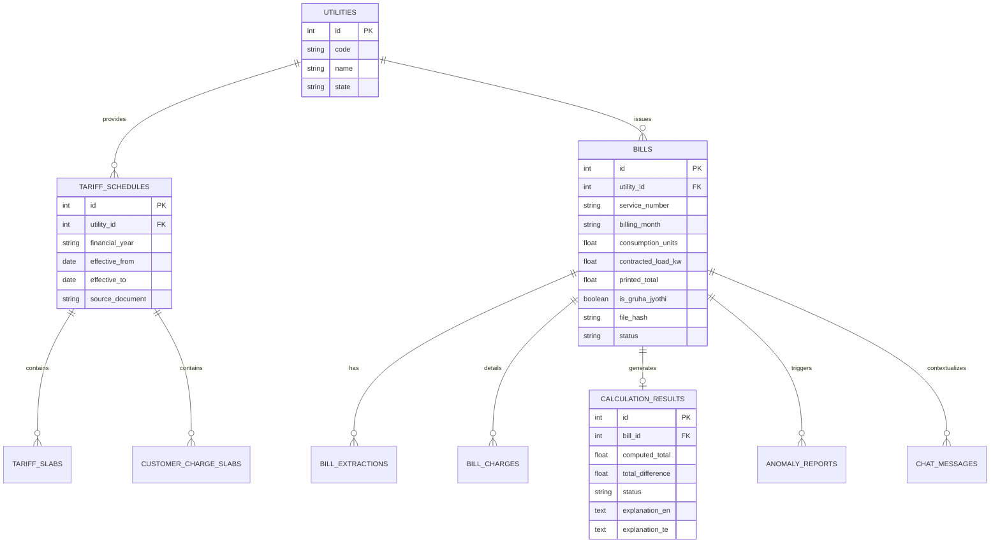

# BIJLI MITRA AI — SYSTEM ARCHITECTURE
## Telangana Government Challenge 13: Personalized Billing Assistance

### 1. High-Level Architecture Overview

**BIJLI MITRA AI** is engineered as a robust, modular monolith combining high-accuracy document processing, deterministic tariff calculations, and grounded bilingual natural language advisory.

---

### 2. Core Architectural Tenets

1. **Deterministic Calculation Integrity:**
   - LLMs are strictly prohibited from calculating electricity bills.
   - All rate lookups, bracket shifts, fixed charges, customer charges, electricity duties, and True-Up recoveries are executed deterministically by Python algorithms validated against official gazetted orders.

2. **Strict Tariff Versioning by Effective Dates:**
   - Tariff schedules are versioned by exact effective dates (e.g. FY 2023-24 from 01.04.2023 to 31.03.2024; FY 2024-25 from 01.11.2024 to 31.03.2025; FY 2026-27 from 01.04.2026 to 31.03.2027).
   - Historical bills are never calculated using current rates.

3. **Explicit Charge Separation:**
   - Every bill component (Energy Charges, Customer Charges, Fixed Charges, Electricity Duty, FSA/FCA, True-Up Recovery, Arrears, Adjustments, Subsidies) is itemized separately.
   - In accordance with TGERC directives, True-Up charges and FSA charges are never bundled into energy charges.

4. **Consumer Verification Workflow (Module 4):**
   - The platform never silently overwrites consumer inputs or accepts low-confidence OCR blindly.
   - Consumers review and confirm extracted values prior to calculation.

5. **Citizen Privacy & Security:**
   - File uploads are validated, size-limited, and fingerprinted using SHA-256 for duplicate detection.
   - Personally Identifiable Information (PII) is kept isolated from public regulatory data.
   - Citizen data is never transmitted to external third-party model providers.

---

### 3. Database Entity Relationship Diagram

